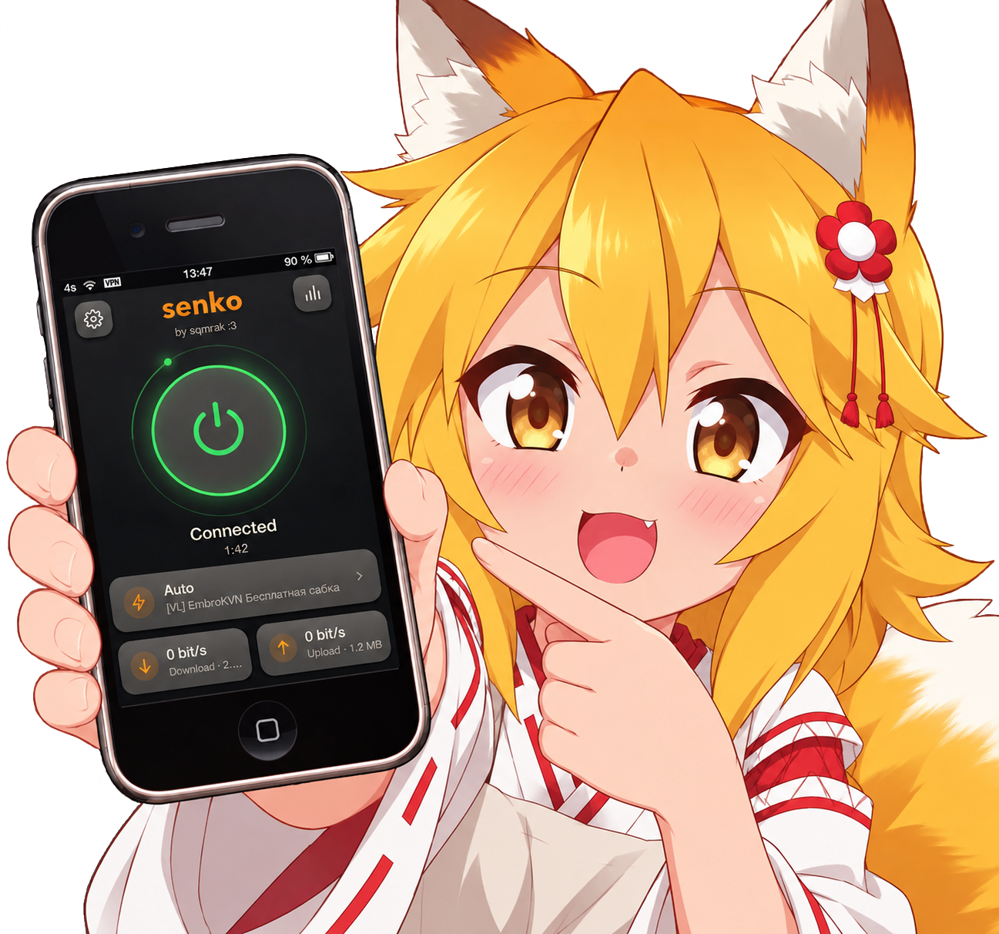

# senko

<p align="center">
  
</p>

<p align="center"><b>vless, hysteria2 and amneziawg for the whole device, ios 4.3 to 16, one deb</b></p>

> [!NOTE]
> all devices need a jailbreak.

## devices

- ios 4.3-6: armv7
- ios 7-11: armv7, arm64
- ios 12-16: arm64, arm64e

## protocols

- vless: tcp, tls, reality, websocket, xhttp, grpc
- vmess: aead, tcp, tls, websocket, xhttp, grpc; below ios 12 tcp, udp and dns
- hysteria2: salamander, pinned certificate; below ios 12 tcp and dns only; xray `quicParams` rates and timers are not imported
- amneziawg
- socks5, http(s)

subscriptions: uri lists, base64, happ, xray/sing-box json, clash yaml, shadowrocket/surge ini. up to 1024 catalog entries, including alternate transports and unsupported rows.

## subscriptions

- add subscription: paste a url
- menu button on the server list: subscription actions, or a picker with more than one
- same button per subscription: refresh, ping, details, edit, remove
- refresh and ping icons: instant checks
- tap a heading: show or hide its servers

## amnezia premium

- add: paste, scan or import a `vpn://` premium key (the one with `auth_data`). a key that carries a ready config still goes through the plain amnezia import
- senkod trades the key for an amneziawg profile at `gw.amnezia.org` (plain http, the body is sealed with aes-256-cbc and rsa pkcs#1 v1.5 under the gateway key) and keeps the key in `/var/root/Library/Preferences/senko-premium.json`, root only
- the profile is written to the one saved amneziawg profile. the gateway issues it for about two hours: connecting with an expired one fetches a new one first
- manual group menu: the countries the gateway lists for amneziawg (vless-only countries are left out), and a new profile
- the premium profile cannot be edited. removing the profile removes the key and releases the device slot at the gateway. a plain amneziawg import replaces it the same way
- the gateway key is read out of the AmneziaVPN 5.0.3.0 and 5.1.0.6 builds, see `daemon/core/amnezia_gateway_key.inc`. requests send `app_version` 5.1.0.6: the gateway refuses older versions with 501, raise `AMZ_GATEWAY_APP_VERSION` when it does again
- left out: the proxy failover through the s3 storages the official client keeps for blocked networks, captcha answers, vless profiles

## vless encryption

- not in the protocol list above on purpose: it has run against the xray server on the host only, no armv7 or arm64 device has dialed it yet
- the `encryption` of a vless user, as `xray vlessenc` prints it: `mlkem768x25519plus.<native|xorpub|random>.<0rtt|1rtt>[.<padding>].<key>[.<key>]`
- a key is an x25519 public key (the server "password", 32 bytes) or an ml-kem-768 encapsulation key (1184 bytes), unpadded base64url. up to 4 keys, 4095 characters in all, so one ml-kem key and a few x25519 keys, not three ml-kem keys. an ml-kem key is checked against fips 203 on import
- padding is `prob-min-max` integer triples, length then gap then length. the first length must be 100 percent and at least 35. total length stays under 65553
- read from: share links (`encryption=`), xray json (`users[].encryption`), clash meta (`encryption:`). sing-box json, surge and karing backups cannot carry it; an export with such a node fails instead of writing plain vless. a profile that does not parse is refused with the field at fault, never read as `none`
- the profile text is kept once per process in a pool of 128 (`vlenc_conf.c`), the server record holds its id. the catalog file keeps the link with the text, so a restart pools it again. a 129th distinct profile is refused until senkod restarts
- backends: the utun and connect-hook backends run it in `core/vlenc_conn.c` over any stream transport (tcp, tls, reality, websocket, xhttp, grpc), with or without vision. senko-core gets the same string in its vless outbound
- vision: after the direct command both directions drop the encryption records and carry the inner tls records on the connection below, as xray does. the transport below stays in use (tls or reality keep protecting it). the `random` profile keeps masking the inner record headers
- 0rtt: the ticket a server hands out is kept in memory (8 slots, never written to disk), scoped to host, port and profile. a server that dropped it ends that one connection and the next one starts a full handshake
- aes-256-gcm is used on arm64, chacha20-poly1305 on armv7 (no aes instructions there). the server accepts either
- not done: the pauses between padding fragments are read and checked but not applied, the fragments themselves are sent. the handshake gives up after 20 seconds, checked on the next read or write
- checks: `make -C tests test` (blake3 vectors, profile table, record layer against an in-tree server, transport over a socketpair), `tests/interop/run_vlenc_interop.sh` (the c client against xray's own `ServerInstance`), `tests/interop/run_vless_e2e.sh` (curl through senkod and the pinned core to a real xray inbound)

## karing backups

- import a Karing ZIP through add, import from file; existing subscriptions are kept
- settings, backup, export Karing backup writes `Documents/senko-karing.backup.zip`
- the archive contains servers and subscriptions, not settings or routing rules
- the export fails if a server uses settings that cannot be represented without loss
- imports reject certificate pins and other connection options the parser cannot preserve

## routing

- settings, routing: profile, geo data, apps with icons, domain rules
- happ profile: the `routing` header or a `happ://routing/` line of a subscription
- profile applies at the next connect; unmatched traffic follows `GlobalProxy`
- geosite and geoip: `Geoipurl` and `Geositeurl` of the profile, loyalsoldier by default, kept per tag in `/var/root/Library/Preferences/senko-geo`
- not matched: `regexp:` and `ext:` entries, dns fields of the profile
- app rules: utun backend and amneziawg, the app is the process that holds the socket, safari pages on ios 8 and later are not caught
- amneziawg with rules: direct and blocked flows leave through the local stack, domain block rules do not apply
- app rules skip senko-core (auto picks utun); geo rules reach it through the geosite.dat and geoip.dat of the geo directory

## features

- servers and subscriptions, paste, qr and file import
- parallel checks, even with the vpn on
- rules: proxy, direct, block, by domain, address, geosite, geoip or app
- failover and auto reconnect
- russian, english, chinese
- diagnostics in the app or `senkoctl`

## install

repo: `https://sqmrak.github.io/sqmrakdev/`

```bash
scp senko-*.deb root@<device-ip>:/var/mobile/
ssh root@<device-ip> dpkg -i /var/mobile/senko-*.deb
```

remove: `dpkg -r com.senko.daemon`

## paths

- config: `/var/root/Library/Preferences/senko.cfg`
- socket: `/var/tmp/senkod.sock`
- log: `/var/log/senko-system.log`
- diagnostics: `Documents/senko-diagnostics.txt`

## build

```bash
make -C tests test
./build_deb.sh
```

needs `THEOS SENKO_SDK_V7 SENKO_SDK_V64 SENKO_SDK_VE SENKO_CRT_V7 SENKO_OSSL_V7 SENKO_OSSL_V64 SENKO_MBED SENKO_GO SENKO_CORE_SRC SENKO_NGTCP2_SRC SENKO_NGHTTP3_SRC SENKO_QUIC`, outputs `senko-v<version>.deb`.

`make -C tests test-native` runs the Go TUN tests with the race detector. set `SENKO_GO` and `SENKO_CORE_SRC` to the pinned toolchain and core checkout. the package build runs these tests too.

`scripts/patches/senko-core-tun-udp.patch` fixes the core's unbalanced gvisor packet clone, UDP deadlines, datagram sizes, queue bounds and flow teardown. builds apply it through a Go overlay without changing the core checkout.

## license

[gpl v2](LICENSE). emoji: Twemoji, CC BY 4.0 (`app/emoji/`).
